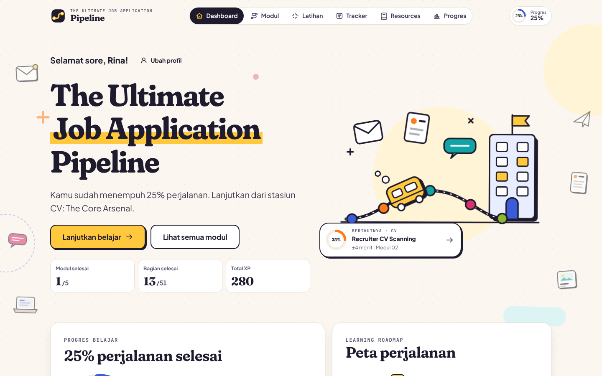

# The Ultimate Job Application Pipeline

LMS mandiri untuk membantu pencari kerja menyiapkan identitas digital, CV & portofolio,
profil LinkedIn, email lamaran, serta follow-up dan pelacakan lamaran.



- **Teknologi:** HTML5, CSS3, JavaScript murni (ES modules), GSAP 3.12.5 + ScrollTrigger, LocalStorage, JSON
- **Tanpa** framework, tanpa build step, tanpa backend, tanpa akun, tanpa API key
- **Hosting:** statis (GitHub Pages)

---

## Fitur (V4: aplikasi ringkas, satu halaman = satu fungsi)

| Halaman | Isi |
|---|---|
| Sidebar global | 8 menu dalam 5 grup (*Overview, Learning, My Progress, Resources, Settings*) dengan ikon Lucide. Desktop: tetap & bisa diciutkan (264 → 80px, tersimpan). Tablet: rel ikon + overlay. HP: drawer + hamburger + backdrop |
| Dashboard | Pusat kendali satu layar: sapaan, **rekomendasi aksi berikutnya** (lanjut materi / ulang kuis / tandai modul selesai / evaluasi / sertifikat), progres keseluruhan, modul aktif, **target harian** opsional (tanpa streak & penalti), ringkasan XP & badge, pintasan 5 modul, akses cepat Practice & Evaluation. **Panduan pengguna baru** 3 langkah (bisa dilewati/diulang) |
| Learning Modules | Katalog 5 modul: nomor, judul, deskripsi, ilustrasi, durasi, status, progres, tombol Mulai/Lanjutkan |
| Detail modul | `module.html?id=…`: ringkasan modul, progres, daftar materi & bagian, kuis, ringkasan & selesai, feedback |
| **Lesson player** | `module.html?id=…#bagian`: layout 100dvh, **satu bagian per layar**; bagian panjang dibagi otomatis menjadi beberapa layar per kelompok blok (teks materi tidak diubah). Bar bawah tetap: Sebelumnya · `03 / 25` · Berikutnya/Selesai. Aktivitas bernilai harus dikerjakan sebelum lanjut. Daftar bagian, mode fokus, tombol layar penuh (hanya lewat klik) |
| Practice Center | Direktori 29 latihan dalam 5 tab per modul; setiap latihan punya workspace sendiri (`practice-tool.html?id=…`) yang memakai blok materi yang sama (hasil & XP tercatat sekali). Termasuk **Gmail Signature Practice** (baru, tanpa XP) dan Email Subject Generator |
| Evaluation | 5 kuis modul + Evaluasi Akhir (15 soal acak dari 20, lulus 75): jumlah soal, nilai lulus, skor terbaik, percobaan, Mulai/Ulangi → `quiz.html?id=…` |
| Learning Progress | Analitik dalam tab: skor kuis per modul (garis nilai lulus), materi selesai, aktivitas 14 hari, Evaluasi Akhir, per modul, skor belajar & 13 aktivitas bernilai, riwayat, **feedback modul** (lihat/ubah/hapus) |
| Achievements & XP | Total XP, 10 badge utama (Didapat / Sedang berjalan / Terkunci + rincian syarat), badge berikutnya, milestone, tabel XP, status sertifikat |
| Sertifikat | `certificate.html`: terbuka setelah 5 modul selesai + Evaluasi Akhir lulus. PDF dibuat di browser (nama, pelatihan, tanggal, ringkasan hasil, ID lokal). **Bukan sertifikasi resmi** (lihat Batasan hosting statis) |
| Resources & Guides | 11 sumber, saring per modul/jenis, pencarian, label "Perlu verifikasi" |
| Settings | Tema terang/gelap/sistem, ukuran huruf, gerak animasi, profil, ulangi panduan, cadangan/pemulihan JSON, reset (konfirmasi + urungkan), salinan data rusak, **data Job Tracker versi lama** (unduh/hapus, hanya tampil bila ada) |
| Gamifikasi | XP (bagian 10, kuis 50, modul 100, checklist 20, aktivitas 15, lembar kerja 15, simulator 40, evaluasi 150), sekali per aktivitas; 10 badge utama + milestone |

**Job Tracker dihapus di V4.** Halaman, menu, kartu, dan kodenya sudah tidak ada. Data lama di `ujap:tracker` tidak dihapus otomatis: Settings menampilkannya dengan pilihan unduh atau hapus (dengan konfirmasi), dan cadangan tetap menyertakannya. Badge *Application Pipeline Manager* kini mensyaratkan Modul 5 selesai + lulus *Application Status Management* & *Follow-Up Timing Scenario*.

## Struktur folder

```
ujap/
├── index.html            ← pintu masuk (mengalihkan ke dashboard.html)
├── 404.html              ← halaman "tidak ditemukan" mandiri untuk GitHub Pages
├── dashboard.html  modules.html  module.html  practice.html
├── resources.html  progress.html  achievements.html  evaluation.html  quiz.html
├── practice-tool.html  certificate.html  settings.html  styleguide.html
├── .nojekyll             ← GitHub Pages menyajikan file apa adanya (tanpa Jekyll)
├── assets/  (icons/sprite.svg + LICENSE-lucide.txt · illustrations/ · deco/ · images/favicon.svg)
├── css/     (tokens · base · layout · components · animations · pages/*)
├── data/    (modules.json · content/{id,cv,li,tx,tr}.json · references.json · resources.json ·
│             simulator.json · evaluation.json)
├── js/
│   ├── app.js            ← satu titik masuk; memuat modul halaman via <body data-page>
│   ├── core/             ← storage, state, feedback-store, prefs, backup, navigation, motion, ui, …
│   ├── features/         ← lesson-renderer, quiz, exercises, activities, simulator, module-card, clipboard,
│   │                        pdf-certificate, practice-catalog, subject-generator
│   └── pages/            ← satu file per halaman
├── vendor/gsap/          ← GSAP & ScrollTrigger (lokal, tanpa CDN)
└── docs/                 ← screenshot & laporan QA
```

## Menjalankan di komputer sendiri

Situs memakai ES modules dan `fetch()` ke file JSON, jadi **harus dibuka lewat server lokal**.
Bila dibuka langsung sebagai file (`file://`), halaman tampil tetapi fitur tidak berjalan.

```bash
cd ujap
```

```bash
python3 -m http.server 8000
```

Buka `http://localhost:8000` di browser. Hentikan server dengan `Ctrl + C`.

---

## Deploy ke GitHub Pages

### 1. Buat repository

1. Masuk ke github.com, klik **+** (kanan atas), lalu **New repository**.
2. Isi **Repository name**, misalnya `job-pipeline`. Nama ini menjadi bagian URL.
3. Pilih **Public**. GitHub Pages gratis untuk repository publik. Di akun gratis, repository privat tidak bisa memakai Pages.
4. Jangan centang "Add a README", karena README sudah ada di proyek.
5. Klik **Create repository**.

### 2. Unggah seluruh proyek

**Cara A: lewat browser (tanpa Git)**

1. Di halaman repository yang masih kosong, klik **uploading an existing file**.
2. Buka folder `ujap` di Finder, pilih **semua isinya** (bukan folder `ujap`-nya), lalu seret ke halaman GitHub.
   - File tersembunyi `.nojekyll` tidak terlihat di Finder. Tekan `Cmd + Shift + .` untuk menampilkannya, lalu ikut seret.
3. Tunggu sampai semua file terunggah, lalu klik **Commit changes**.

**Cara B: lewat Terminal (Git)**

Ganti `USERNAME` dan nama repository di perintah ketiga dari belakang.

```bash
cd ujap
```

```bash
git init
```

```bash
git add .
```

```bash
git commit -m "Rilis pertama The Ultimate Job Application Pipeline"
```

```bash
git branch -M main
```

```bash
git remote add origin https://github.com/USERNAME/job-pipeline.git
```

```bash
git push -u origin main
```

### 3. Pastikan `index.html` di lokasi yang benar

`index.html` harus berada di **akar repository**, sejajar dengan `dashboard.html`, `css/`, dan `js/`.

```
✅ benar   job-pipeline/index.html
❌ salah   job-pipeline/ujap/index.html
```

Kalau yang terunggah ternyata folder `ujap/` utuh, pindahkan isinya ke akar repository, atau pilih folder lain di langkah 5.

### 4. Aktifkan GitHub Pages

1. Di repository, buka **Settings**, lalu **Pages** (menu kiri, bagian *Code and automation*).
2. Di **Build and deployment → Source**, pilih **Deploy from a branch**.

### 5. Atur branch dan folder

1. **Branch:** `main`
2. **Folder:** `/ (root)`
3. Klik **Save**.

### 6. Buka situsnya

Setelah 1–3 menit, tautan situs muncul di bagian atas halaman **Settings → Pages**. Formatnya:

```
https://USERNAME.github.io/job-pipeline/
```

Progres deploy bisa dipantau di tab **Actions** (alur kerja *pages build and deployment*).

Setelah situs online, lakukan pengecekan ini:

- [ ] Halaman utama terbuka dan langsung pindah ke Dashboard.
- [ ] Semua menu sidebar (Dashboard, Learning Modules, Practice Center, Evaluation, Learning Progress, Achievements & XP, Resources & Guides, Settings) bisa dibuka, termasuk lewat drawer di HP.
- [ ] Ilustrasi dan ikon tampil. Kalau ada yang hilang, periksa huruf besar/kecil nama file.
- [ ] Selesaikan satu bagian modul, muat ulang halaman, lalu pastikan progres tetap tersimpan.
- [ ] Buka alamat yang tidak ada (misalnya `/job-pipeline/abc`). Halaman 404 harus muncul dengan tombol ke Dashboard.
- [ ] Buka tiap tautan di halaman **Resources**. Kalau halamannya benar, ubah `"verified": false` menjadi `true` di `data/resources.json` atau `data/references.json`.

### 7. Memperbarui situs setelah deploy

Ubah file, lalu unggah ulang:

- **Lewat browser:** buka file di GitHub, klik ikon pensil, edit, lalu **Commit changes**. Atau pakai **Add file → Upload files** untuk mengganti file.
- **Lewat Terminal:**

```bash
git add .
```

```bash
git commit -m "Jelaskan perubahan di sini"
```

```bash
git push
```

GitHub Pages memperbarui situs otomatis dalam 1–3 menit. Kalau perubahan belum terlihat, muat ulang paksa dengan `Cmd + Shift + R`. Browser dan CDN GitHub menyimpan cache file sekitar 10 menit.

**Data pengguna tidak hilang saat situs diperbarui.** Progres tersimpan di LocalStorage browser masing-masing pengguna, terpisah per alamat situs. Hanya ada satu pengecualian: kalau alamat situs berubah (nama repository diganti atau pindah ke domain lain), pengguna perlu memindahkan data lewat **Progres → Unduh cadangan**, lalu **Pulihkan dari file** di alamat baru.

---

## Batasan hosting statis

GitHub Pages hanya menyajikan file. Konsekuensinya:

| Kebutuhan | Kondisi sekarang | Kalau suatu saat diperlukan |
|---|---|---|
| Menyimpan data | LocalStorage per browser/perangkat | Backend + database (mis. Supabase/Firebase) + login |
| Sinkron antarperangkat | Manual lewat file cadangan JSON | Akun pengguna + database |
| Fitur AI (mis. Gemini) | **Tidak ada.** Semua alat berbasis aturan, tanpa API | Serverless function (Cloudflare Workers, Netlify/Vercel Functions) yang menyimpan API key di server. **Jangan pernah** menaruh API key di file JS/HTML proyek ini, karena semua file di GitHub Pages bisa dibaca publik. |
| Sertifikat yang bisa diverifikasi | ID lokal (hash tanggal + nama) di PDF buatan browser. Data LocalStorage bisa diubah pemilik perangkat, jadi sertifikat **tidak** membuktikan apa pun ke pihak ketiga | Backend yang menerbitkan & menyimpan sertifikat bertanda tangan digital + halaman verifikasi |
| Header keamanan HTTP | CSP lewat `<meta>` (GitHub Pages tidak bisa mengatur header) | Hosting dengan header kustom atau Cloudflare di depan |

## Keamanan

- Tidak ada API key, token, atau secret di proyek ini.
- Input pengguna selalu dimasukkan lewat `textContent` (`js/core/dom.js`). Tidak ada `innerHTML` maupun `eval`.
- **Content Security Policy** di setiap halaman: hanya skrip dari situs ini, plus satu skrip boot inline yang di-hash.
  - Kalau skrip `<script>` kecil di `<head>` diubah, hitung ulang hash-nya, lalu ganti nilai `sha256-…` di **semua** file HTML. Perintah untuk menghitungnya:

```bash
python3 -c "import re,hashlib,base64;s=open('dashboard.html').read();print(base64.b64encode(hashlib.sha256(re.search(r'<script>(.*?)</script>',s,re.S).group(1).encode()).digest()).decode())"
```

- Tautan eksternal memakai `target="_blank" rel="noopener noreferrer"`, dan hanya URL `https://` yang dirender sebagai tautan.
- Data yang disimpan hanya yang diperlukan fitur: nama panggilan (opsional), progres, preferensi, dan feedback. Data ini hanya ada di perangkat pengguna.
  - File cadangan berisi data tersebut, jadi simpan dengan aman.

## Panduan perawatan

| Tugas | Lokasi |
|---|---|
| Mengubah teks materi, kuis, latihan | `data/content/<id>.json` (blok yang didukung tercantum di `js/features/lesson-renderer.js`) |
| Mengubah pengelompokan materi | `topics` di `data/modules.json` — urutan `lessons` tiap topik harus sama dengan urutan `lessons` modul |
| Menambah aktivitas bernilai | Blok `scenario` / `match` / `order` / `spot` / `keywords` dengan `id` unik, lalu daftarkan id-nya di `SCORED_ACTIVITIES` (`js/core/state.js`) dan `ACTIVITY_INFO` (`js/pages/progress-page.js`) |
| Mengubah skenario simulator / rubrik | `data/simulator.json` (lowongan, kata kunci) dan fungsi `evaluate()` di `js/features/simulator.js` (bobot kriteria) |
| Mengubah soal Evaluasi Akhir | `data/evaluation.json` (`count` = jumlah soal per percobaan) |
| Mengubah syarat badge | `BADGES` di `js/core/state.js` — badge baru wajib bergantung pada aktivitas yang tercatat, bukan diberikan otomatis |
| Mengubah judul/durasi bagian modul | `data/modules.json`. **Jangan mengganti `id` bagian** (`id-1`, `cv-3`, …), karena progres pengguna terikat ke id tersebut. Menambah bagian baru aman, tapi persentase progres pengguna lama akan turun sedikit. |
| Menambah resource | `data/resources.json` (`module`, `type`, `title`, `source`, `url`, `about`, `verified`) |
| Menambah referensi | `data/references.json`, lalu cantumkan `id`-nya di `references` pada file konten modul |
| Mengubah warna/tipografi | `css/tokens.css` (design token). Pratinjau di `styleguide.html` |
| Menambah ikon | `assets/icons/sprite.svg` (`<symbol id="i-nama">`), lalu pakai `icon('nama')` |
| Menambah/mengubah latihan di Practice Center | `js/features/practice-catalog.js` (id, judul, ikon, sumber blok materi, cara menghitung status). Latihan memakai blok materi yang sama, jadi jangan menyalin soal |
| Mengubah segmentasi layar lesson player | `paginate()` di `js/pages/module-detail.js` (dibagi per kelompok blok sesuai tinggi panel) |
| Mengubah menu sidebar | `NAV_GROUPS` di `js/core/navigation.js`; ikon baru ditambah ke `assets/icons/sprite.svg` |
| Mengubah langkah panduan / logika rekomendasi | `guideSteps()` di `js/pages/dashboard.js` · `getRecommendation()` di `js/core/state.js` |
| Mengubah isi/tampilan sertifikat PDF | `js/pages/certificate.js` (data & teks batasan) · `js/features/pdf-certificate.js` (tata letak PDF, hanya karakter Latin/WinAnsi) |
| Mengubah warna mode gelap | blok `html[data-theme="dark"]` di `css/tokens.css` |
| Mengubah skema LocalStorage | `js/core/state.js` (`sanitizeState`) dan `js/core/feedback-store.js`. Selalu buat field baru opsional agar data lama tetap terbaca. |
| Memperbarui GSAP | Ganti file di `vendor/gsap/`, lalu uji ulang animasi dan mode gerak minimal |

Sebelum setiap rilis:

- [ ] Jalankan server lokal, lalu buka semua halaman dengan DevTools → Console terbuka. Pastikan tidak ada error merah.
- [ ] Coba alur utama: buka modul, maju-mundur di lesson player, kerjakan satu latihan di Practice Center dan satu kuis di Evaluation, lalu unduh cadangan dari Settings.
- [ ] Periksa tampilan di lebar HP (DevTools → Toggle device toolbar, 390px).
- [ ] Unduh cadangan secara berkala bila memakai situs untuk diri sendiri.

## Lisensi pihak ketiga

- Ikon navigasi & pemutar V4 dari [Lucide](https://lucide.dev) (lisensi ISC, `assets/icons/LICENSE-lucide.txt`).
- **GSAP 3.12.5 & ScrollTrigger:** © GreenSock, dipakai sesuai [GSAP Standard License](https://gsap.com/standard-license) (gratis untuk proyek seperti ini).
- **Google Fonts:** Fraunces, Plus Jakarta Sans, JetBrains Mono (SIL Open Font License).
- Ikon lain, ilustrasi, dan dekorasi dibuat khusus untuk proyek ini.
